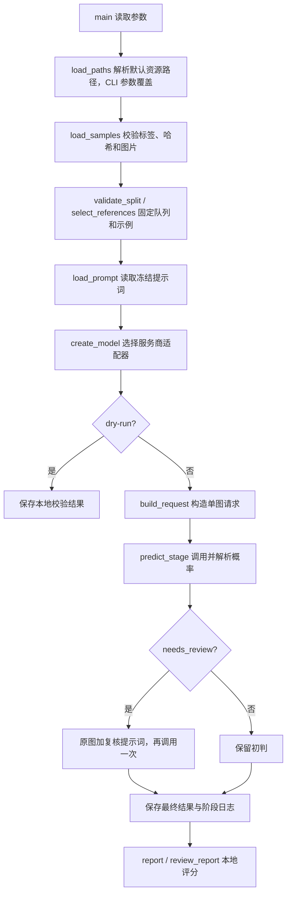

# Agent 代码导读

先读 `src/he_agent.py` 的 `main → run`，再按调用位置读参考选择、提示词、模型与复核模块。每个业务文件的顶部说明其职责；函数 docstring 说明输入、输出或边界，关键行注释解释“为什么这样做”。数据准备与实验分析均在 `scripts/`，不会随推理自动执行。

## 1. 一次运行的数据流

每张图片使用独立请求。可上传参考图及参考标签；待测图的标签、UUID、来源、分组和评分不进入请求。`ModelRequest` 只包含提示词和有序文本／图片，建立明确的数据边界。

## 2. 主推理文件

| 文件 | 核心函数及职责 |
| --- | --- |
| [project_paths.py](../src/project_paths.py) | `load_paths` 延迟读取并校验路径 JSON、解析项目相对路径；`ProjectPaths.metadata` 提供运行配置指纹；`display_path` 兼容外置数据溯源。目录默认值只在 `configs/paths.json` 维护 |
| [he_agent.py](../src/he_agent.py) | `main` 解析 CLI；`run` 串联完整流程；`load_samples` 只读主标签清单；`build_request` 组织示例与待测原图；`parse_prediction` 校验概率 JSON；`metrics/report` 计算总体和来源指标；`dump` 写快照 |
| [reference_split.py](../src/reference_split.py) | `validate_split` 检查成员、标签、哈希与组隔离；`select_references` 从冻结池选择类别平衡的 4／6／8 图前缀。只读，不生成划分 |
| [prompt_profiles.py](../src/prompt_profiles.py) | `load_prompt` 返回提示词、版本元数据、可选来源清单；通过哈希防止医学内容与实验版本混用 |
| [selective_review.py](../src/selective_review.py) | `validate_review_threshold/needs_review` 决定分流；`predict_stage` 调用、解析和错误记录；`token_usage` 合并用量；`review_report` 在同一批有效图片上比较初判／最终 |

`run` 内分为校验、选样、建立客户端、写输入快照、逐图调用、评分六步。`save_stage` 在复核前立即保存初判；逐图日志 flush 保留中断前进度。致命错误停止后续调用，未完成图计入 unattempted。

### 三处最容易读错的逻辑

1. `status == "ok"` 才参与概率评分。null、错误和未完成单独计数；不能当作 0，也不能靠排除难例声称提升。
2. `lower < p1 < threshold` 是严格开区间，刚好等于边界不复核。`threshold` 在线同时管分类和复核上界；离线脚本可将二者分开。
3. 复核完成后覆盖最终概率，包括复核弃权／失败，不取最大值。配对评价只用两阶段均有效的样本，避免把弃权当成纠正漏判。

## 3. 模型接口

| 文件 | 职责 |
| --- | --- |
| [models/base.py](../src/models/base.py) | `TextPart/ImagePart/ModelRequest/ModelResponse` 定义通用协议；`ModelClient` 约定接口；`ModelError.fatal` 告诉主流程是否停止 |
| [models/__init__.py](../src/models/__init__.py) | `create_model` 从注册表选择适配器，未知 provider 报错 |
| [models/credentials.py](../src/models/credentials.py) | `read_api_key` 环境优先、文件兜底；`load_local_keys` 校验 JSON，错误不带密钥内容 |
| [glm.py](../src/models/glm.py)、[deepseek.py](../src/models/deepseek.py)、[openai.py](../src/models/openai.py) | 各服务商的编码、HTTP、有限重试与响应归一化 |

三个适配器均有 `validate_credentials → describe → build_payload → _post → normalize_response → generate` 这些职责，`generate` 实际串联编码、发送和归一化。只有主流程理解诊断概率；适配器只处理协议。

- 原图 Base64 编码不改变图片字节，参考图与待测图顺序保持不变。
- GLM／DeepSeek 读取 choices 内最终文本；OpenAI 遍历 output，只收集 assistant 的 output_text，不能假定第一项就是回答。
- finish_reason=length 等不完整输出必须报错。模型正常输出的 null 与 API 拒绝不是同一状态。
- 临时错误有限退避重试；重定向被禁用，异常正文不进入日志。用量仅计已返回 token，不能等同完整账单。

## 4. 数据准备与离线分析

| 路径 | 输入 → 输出与使用时机 |
| --- | --- |
| scripts/data/merge_he_dcnn.py | 原库清单／目录标签 → 去重图片与二分类标签；无逐图证据不补标签 |
| scripts/data/prepare_bioengineering_us.py | PDF、提取记录 → 通过模态、器官、标签与字节核验的图片；其余待复核 |
| scripts/data/prepare_web_us_filtered.py | 固定网页批次 → 筛选记录；历史一次性脚本，`--apply` 才应用指定目录删除 |
| scripts/data/merge_processed_uuid.py | 已处理来源 → 字节不变的 UUID 数据集，未标注照片另存 |
| scripts/data/merge_normal_labels.py | 已获准的 Normal 批次 → 主标签表；保留专项排除依据不足的字段 |
| scripts/data/prepare_reference_split.py | 来源／患者／重复图 → 不可拆组及平衡参考池；并查集和计数状态搜索用于维持隔离 |
| scripts/data/reference_diversity.py、reference_balanced.py | 旧划分和来源配额 → 新划分、冻结测试交集；不按预测得分选图 |
| [scripts/analysis/compare_reference_runs.py](../scripts/analysis/compare_reference_runs.py) | 两个单次 run＋冻结交集 → 配对参考方案比较 |
| [scripts/analysis/sweep_thresholds.py](../scripts/analysis/sweep_thresholds.py) | 单个 run 缓存 → 多阈值回放；`load_run` 核验快照，`materialize` 选择阶段，`sweep` 统一评价集合，`run` 写新结果 |

数据脚本的数量断言对应历史批次，不是医学规则；dHash 缩略图仅用于近重复分组，上传仍用原图。已完成的数据不要为正常推理重新清洗。

## 5. 历史原型与维护

`experiments/expert_lab/` 保留权重检查、编码器和检索的离线验证；`experiments/rag_harness/` 保留两阶段／知识卡原型。它们不是当前主入口。第三方摘录位于独立研究目录，不作为主项目源码重写。

单元测试位于 `tests/`，覆盖概率边界、真值隔离、参考组隔离、适配器响应／错误、复核门控和缓存缺失。运行检查命令见根 [README](../README.md)。新增 provider 实现通用接口，新增模式组合输入因素；不要将厂商格式写进指标函数，也不要让数据脚本依赖模型预测。
