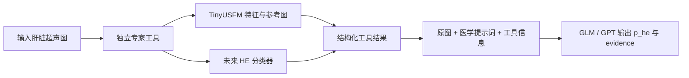

# 专家模型探索：可复现到哪一步，以及如何接入 Agent

检索与实验日期：2026-09-18。

## 结论

适合当前阶段的路线是：**先拿到真实可加载的超声编码器，形成特征/参考图检索工具；同时向 HE_DCNN 作者申请疾病权重和类别说明。** 后续补充有可信诊断标签的训练数据，再训练二分类头。

本轮已在 CPU 跑通 TinyUSFM 官方预训练权重，对固定参考池 44 张图提取 192 维特征，产出 4 个参考图查询示例。没有开展测试集评价，不能给出有效性结论或宣称识别率提高。现有 44 张参考图中阳性 42 张、阴性仅 2 张，直接训练后展示高准确率很容易误导。

## 候选模型核查

| 候选 | 真实任务与模态 | 公开资源核查 | 对本项目的判断 |
|---|---|---|---|
| HE_DCNN | 肝脏超声五分类，适合进一步聚合为患病概率 | 官方源码可得；README 的预训练链接是 ImageNet；推理用 `epoch_200.pth` 是本地路径。本次仓库树和 Releases 未发现发布的疾病权重 | **疾病分类专家首选候选**，但需要作者 checkpoint、类别顺序、预处理和训练数据重叠说明 |
| HES-UNet | **CT** 上的肝包虫病病灶分割 | 论文 III-A 和 IV-A 明确 CT；本次未找到作者公开权重 | 不能直接作为本任务的超声专家；分割概率也不是患病概率 |
| HASA | 超声包虫病九分类；另一任务是卵巢分割 | 论文给出 AE1–3、CL、CE1–5；本次未找到可直接下载的官方疾病权重 | 缺少明确非包虫病对照类别，不能直接把九分类 softmax 当作患病概率 |
| TinyUSFM | 通用超声预训练视觉编码器，可适配下游任务 | 官方源码和 Google Drive 权重可得；本轮已下载并严格加载 | **当前可实际运行的基础模块**，适合特征提取/参考检索；要成为概率专家还需 HE 监督学习 |
| UltraSam | 通用超声分割，接受点/框等提示 | 官方仓库列出权重链接和 OpenMMLab 运行例程；本轮未下载或运行 | 可作为未来 ROI 分割工具；需要验证包虫病区域分割表现，不能直接输出疾病概率 |

来源：[HE_DCNN 官方仓库](https://github.com/qigtang/HE_DCNN)、[HES-UNet 全文](https://arxiv.org/html/2412.06530v1)、[HASA 全文](https://arxiv.org/html/2204.06697v2)、[TinyUSFM 官方仓库](https://github.com/MacDunno/TinyUSFM)、[UltraSam 官方仓库](https://github.com/CAMMA-public/UltraSam)。其中“未找到”仅指本轮公开资料核查范围，不意味着作者手中没有权重。

### HES-UNet 的关键更正

该论文描述的是 268 名患者的 **CT** 图像与病灶分割，不是超声图像。输入、强度处理和纹理分布都不同。可以学习它的网络设计思想，但目前不能把它当作已经匹配本研究的超声模型。原项目文档本轮按用户要求未修改，本报告明确记录这一更正。依据为论文 III-A、IV-A。

### HASA 为什么不能直接作为二分类器

论文 4.1.1 研究的是已诊断患者中的病变分型，九类中没有清晰的“正常/其他肝病”对照类。CL 也不能草率解释成非包虫病。即使取得九分类权重，各类别概率加起来接近 1 只说明分类空间被归一化，不说明输入患者患病概率为 1。其分割实验针对卵巢，不是包虫病病灶。

## TinyUSFM 实际复现记录

使用官方仓库提交 `f3096e97da3814011c5f59176b5cc19b5477ac64` 的结构和权重链接。

- 公开权重约 22.1 MB，SHA-256：`776a50eeff402802c8cd06e00fe9de73df4161504fa733284bc240904b48252c`。
- 模型 5,524,416 参数，ViT：patch 16、维度 192、12 层、**12 个注意力头**。不能用常见 ViT-tiny 的 3 头默认配置替代。
- 使用 `torch.load(..., weights_only=True)`，只接受张量 state_dict；没有执行来自 checkpoint 的任意 Python 对象。
- 严格加载全部参数，不容许缺失键或多余键；权重 SHA-256 不符则停止。
- 预训练权重含 `norm`，而作者下游 `global_pool=True` 配置新增 `fc_norm`；不应通过 `strict=False` 静默接受随机初始化。本实验保留预训练 CLS token/norm，作为特征提取策略，**未声称复现论文的下游微调成绩**。
- 根据作者验证预处理使用 RGB、224×224、ImageNet 均值/标准差。内存缩放不改变原图文件；正式疾病任务仍需考察缩放对小病灶的影响。
- 依赖采用 torch 2.6.0、torchvision 0.21.0、timm 1.0.15。作者仓库原 requirements 写 timm 0.5.4；本轮使用现代 timm 构造等价编码器，并以作者源码的 `forward_features` 做数值一致性测试，容差 `1e-5`，已通过。
- 所有 44 张参考图的特征均有限且已 L2 归一化；结果矩阵为 `44×192`。一次 CPU 运行含加载约 0.735 秒，仅为本机工程测量，不是正式速度基准。

详细结果：[summary.json](results/tinyusfm_reference_smoke/summary.json)、[测试日志](results/tests.log)、[工具输出](results/tinyusfm_reference_smoke/tool_examples.json)。

### 数据重叠与来源偏差

TinyUSFM 官方 UniUS-Bench 的 AUL 条目指向 [Zenodo 7272660](https://zenodo.org/records/7272660)，与本项目使用的正常肝脏来源相同。**基准收录不等于已经确认预训练泄漏**；仍须核实预训练、蒸馏和各下游 checkpoint 实际用过哪些图片。目前不能宣称本项目测试集对该模型完全独立。

此外，参考池只有 2 张阴性。全池最近邻很可能多数为阳性，这可以是类别组成造成的，不能解释成对查询图的疾病判断。示例不计算准确率，也不使用查询标签选择邻居。

## HE_DCNN 已实现与未实现的边界

`src/he_checkpoint.py` 完成了旧 mmclassification 权重命名到 torchvision ResNet50 的映射、五分类头形状校验、严格加载和缺权重状态。真正的 checkpoint 尚未取得；映射函数通过合成张量测试，**不等于已经验证作者疾病权重能够运行**。

若作者确认正类对应 0/1/2，那么：

```text
p_he = softmax(logits)[0] + softmax(logits)[1] + softmax(logits)[2]
```

不能取最高分、不能把类别索引除以 4、也不能使用 ImageNet 1000 类输出冒充 HE 概率。现有数据整理的 0/1/2→阳性映射可作核查线索，但不能证明未来取得的 checkpoint 也使用相同顺序。

原配置的推理包含短边 256、中心裁剪 224，以及均值 `[117.4,117.4,117.4]`、标准差 `[78.7,78.6,78.7]` 的 RGB 归一化。旧管线使用 OpenCV；加载成功后仍要验证颜色通道、插值和裁剪位置是否一致。本轮没有补一个未经验证的“HE_DCNN 正式推理接口”。

作者提供权重后需取得：对应 config、五类顺序及定义、一个可比对的输入/输出示例、预处理和 ROI 裁剪要求、训练患者/来源重叠说明、使用许可。无需为了加载权重而把现有主项目降级到旧 OpenMMLab 环境。

## Agent 如何使用专家工具



本轮只实现 B→C→E 和 D 的权重兼容性探针；没有改动现有 Agent 的调用链。

通用特征工具返回：`status=features_only`、`p_he=null`、邻居图片/参考标签/相似度和限制说明。分类专家未来才返回 `status=ok`、疾病概率、模型版本、权重指纹、训练来源、校准状态；缺权重则返回 `unavailable`。分割专家应返回 mask/ROI 路径及质量说明，不能把病灶像素比例当作患病概率。

Agent 应明确告知大模型：工具结果不是诊断真值；专家与大模型矛盾时保留原图证据和不确定性。本轮没有设计未经验证的概率加权融合。

## 下一步建议和进入条件

1. **优先申请 HE_DCNN 疾病 checkpoint。** 如果取得权重及类别/预处理证明，先用作者样例验证数值一致性，再审查当前样本是否属于作者训练集。交付加载报告和重叠表后，才做疾病专家对照。
2. **补足训练池阴性，训练 TinyUSFM 冻结特征 + 线性二分类头。** 数据按患者/来源划分，175 张测试图持续冻结；至少要有足以单独划分训练/验证的独立阴性患者，不以“达到某个图片数”替代统计设计。对照 ImageNet ResNet50 同样的线性头，使用类权重；超参数只在训练/验证中决定。类别严重失衡阶段不汇报训练准确率作为泛化能力。
3. **参考图工具先做受控消融。** 固定参考图与 TinyUSFM 检索对照；查询不带测试真值；限定同样张数及正负比例；查询与参考图需排除同患者、近重复和同源衍生切图。数据审核通过后再接入新 Agent 模式。
4. **取得有效分类专家后做 Agent 对照。** 固定测试图、提示词、调用顺序和 GLM/GPT 模型：无工具 vs 加入专家概率/依据。指标为 Brier、log loss、AUROC、覆盖率和调用耗时；有独立校准集后才拟合校准器。报告来源分层和配对不确定性；不能用测试集决定融合权重。
5. **分割工具放在后续。** 先获得肝脏/病灶 ROI 标注，试 UltraSam 点/框提示；分割好坏用 Dice/IoU 与人工标注评估，再评估是否改善疾病概率。只有图片级 0/1 标签时，不能声称监督复现了 UNet 病灶分割。

建议向老师汇报的问题是：“超声预训练特征或疾病分类专家的信息，能否在独立来源测试上改善大模型的患病概率质量？”目前已完成资源核查与可运行工具原型，下一步的主要门槛是疾病权重和可信训练/验证数据。

## 许可与复现说明

TinyUSFM README 声明 Apache 2.0，但本次固定提交的目录树未发现其引用的 LICENSE 文件。源码快照仅作本地核查并注明上游，未重新声明作者权利；对外发布代码副本或权重前应核实实际许可覆盖范围。权重及特征被本目录 `.gitignore` 排除。UltraSam 权重仅核实官方提供链接，本轮未测试可下载性。没有向作者发送邮件。

## 补充验证：特征分布与环境迁移

44 张图的 946 个不同图对，余弦相似度中位数约 0.9908，范围约 0.9278–0.9994（见 [特征统计](results/feature_geometry.json)）。因此示例中的 0.99 不能解释为“99% 患病”或“99% 可靠”；这些特征能否区分疾病仍需独立验证。CLS 与 patch 平均池化可作为未来验证集上的对照，不在当前测试集上挑选方案。

实验已在项目内独立 `.venv` 中再次运行，13 项测试通过；两次 44×192 特征一致。现有 341 个受保护文件 SHA-256 核验无变化，详见 [保护核验](results/protection_check.json)。本轮仅新增 `expert_lab/`。
